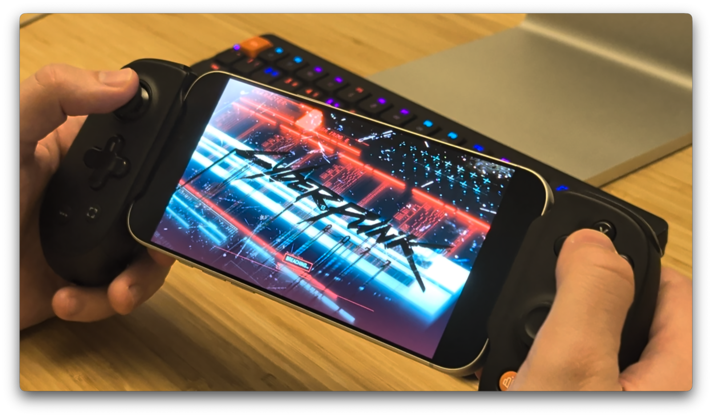

# cyberpunk-ios

<p align="center">
  
</p>

An independent research project exploring compatibility between the Mac App Store
version of Cyberpunk 2077 and iPhone.

Unofficial and not affiliated with or endorsed by CD PROJEKT RED or Apple.
You must purchase your own copy from the Mac App Store. Game use remains subject
to applicable law and the game's licence terms.

## Install

Requires an Apple silicon Mac, Xcode 27+, Tuist, an iPhone with iOS 27+, and
Cyberpunk 2077 2.5.0 installed from the Mac App Store.

```sh
git clone https://github.com/eugenebokhan/cyberpunk-ios.git
cd cyberpunk-ios
tuist generate
```

In Xcode, select your signing team and iPhone, then run. Release is the default;
the game files are copied automatically.

On first launch, connect your CDPR account for cloud saves or skip. Later launches
start the game directly. The Mac is only needed for installation and updates.

Project source is available under the [MIT License](LICENSE), including its
warranty disclaimer and third-party notices. Game executables and asset archives
are not distributed here. The game, its artwork and trademarks remain the
property of their respective owners and are not covered by this licence.
